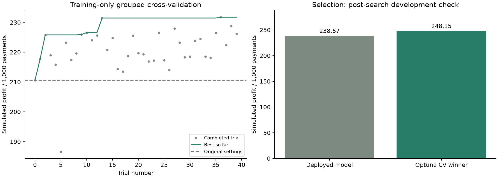

# Optuna: low-margin LightGBM tuning

Executed 2026-10-19. [Notebook 10](../../notebooks/10-optuna-tuning.ipynb), [machine-readable results](../../reports/optuna/lightgbm-low-margin-optuna-v1/results.json), [all 40 trials](../../reports/optuna/lightgbm-low-margin-optuna-v1/trials.csv), and [winning parameters](../../reports/optuna/lightgbm-low-margin-optuna-v1/best-parameters.json) preserve the experiment.

## Search design

Optuna 5.0.0 ran **40 complete trials**, each using the same three seeded, label-stratified, pattern-grouped folds inside the 171,029-payment training split (297 frauds). Each validation fold contained 99 frauds. Duplicate V1–V28/Amount patterns stayed together; Time remained an input. No class weighting, resampling, feature changes, post-hoc calibration, early stopping, or pruning was used.

The objective maximized **pooled out-of-fold simulated profit per 1,000 payments** under the existing +0.3% legitimate margin / −100% fraud-loss scenario. It was not classification accuracy. The cutoff stayed at `0.003 / 1.003 = 0.0029910269`, with ties and zero amounts approved. AP, Brier, fraud recall, and legitimate cancellation rates were logged alongside profit.

The seeded TPE sampler had 10 startup trials; trial 0 used the original LightGBM settings. Trials were sequential, each model used four CPU threads, and the three-fold search therefore fitted 120 classifiers. After the search, its CV winner was fixed before selection was loaded and scored. Calibration and evaluation were excluded. Existing selection data have prior development and EDA exposure.

| Parameter | Search space | Winning value |
| --- | --- | --- |
| Trees | 100–500, steps of 50 | 150 |
| Learning rate | 0.01–0.15, log scale | 0.0591323 |
| Leaves | 7–47 | 13 |
| Minimum child samples | 20–200 | 145 |
| L1 regularization | 0–5 | 0.0476294 |
| L2 regularization | 0–5 | 4.9528603 |
| Row sampling | 0.7–1.0, frequency 1 | 0.8507407 |
| Feature sampling | 0.7–1.0 | 0.7178911 |

Trial **36** won. Training-CV simulated profit rose from **210.60** with the original settings to **231.75 per 1,000** with the winner. Search plus final refit/comparison took approximately 112 seconds on this machine. The best CV value was selected across trials and is an optimistic development estimate, not independent performance evidence.



## Post-search selection comparison

The winner was fitted on the full training split and compared with the exact deployed LightGBM artifact on the same 42,632 selection payments (76 frauds).

| Metric | Deployed LightGBM | Optuna CV winner |
| --- | ---: | ---: |
| Average precision | 0.8421 | **0.8564** |
| Brier score (lower is better) | **0.000432** | 0.000468 |
| Simulated profit / 1,000 | 238.67 | **248.15** |
| Fraudulent payments canceled | 62 / 76 | **65 / 76** |
| Legitimate payments canceled | **90** | 371 |

The tuned policy's point-estimate profit gain is **9.48 per 1,000**, about **3.97%** relative to the deployed model on these selection payments. A 2,000-replicate paired pattern-group bootstrap gives a 95% interval of **−9.12 to +36.86**. The advantage is inconclusive. This interval conditions on the fixed fitted models and reused selection population; it does not fully account for search/training uncertainty or prior analytical exposure.

The tuned model improves ranking and cancels three additional frauds, while canceling 281 additional legitimate payments and worsening overall Brier. Better ranking does not establish better probability calibration near the 0.2991% economic cutoff.

## Artifacts and decision

MLflow experiment `10-optuna-low-margin` contains parent run `f5f9c2a5736e42ac952f8e67c8ac3c42` and 40 finished child runs. Each child records its parameters and pooled/fold metrics. The parent records source/split/configuration/code/version lineage, results, and the fitted tuned model. The local Optuna SQLite study is `data/processed/optuna/lightgbm-low-margin-optuna-v1.sqlite3`; the tuned artifact is `models/tuning/lightgbm-low-margin-optuna-v1.joblib`. Both remain outside Git; the compact reports, trial table, executed notebook, and figure are committed. Saved/reloaded tuned predictions matched to absolute tolerance 1e-12.

**Decision:** retain the tuned model as a separate development candidate for calibration and subsequent evaluation. The running API model and its registry alias are unchanged. No new final evaluation or production-profit claim follows from this experiment. Historical frozen inputs and the deployed model checksum were verified unchanged. Eighteen Python tests and both JavaScript policy tests passed, including a new guard against selection/evaluation leakage into tuning folds.

## Reproduce

From the existing Poetry development environment:

```bash
poetry run python -m pip install --no-deps -r requirements-tuning.txt
poetry run python -m scripts.run_optuna --trials 40 --study-name lightgbm-low-margin-optuna-v2
```

`requirements-tuning.txt` adds Optuna, colorlog, and tqdm at recorded versions without changing the historical `pyproject.toml`, `poetry.lock`, or inference dependencies. Remaining Optuna dependencies are already supplied by the Poetry environment. A new study name preserves prior SQLite studies and report directories; the runner refuses to overwrite existing reports. Original seeded uninterrupted runs are reproducible within the recorded environment; parallel trials and resume behavior are not implemented.

Implementation references: [Optuna TPE sampler](https://optuna.readthedocs.io/en/stable/reference/samplers/generated/optuna.samplers.TPESampler.html) and [study creation/storage](https://optuna.readthedocs.io/en/stable/reference/generated/optuna.create_study.html).
